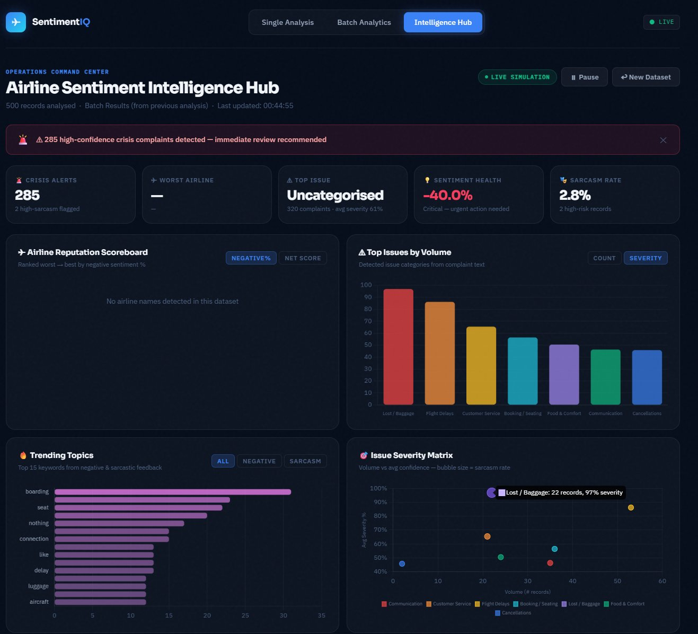

<div align="center">

# ✈️ Airline Sentiment Intelligence Platform

**A production-grade MLOps system that automatically trains, evaluates, and deploys a real-time sentiment analysis engine — complete with a sarcasm detection module and a full operations intelligence dashboard for airline brand monitoring.**

<br/>

[](https://github.com/features/actions)
[](https://huggingface.co/distilbert-base-uncased)
[](https://aws.amazon.com/sagemaker/)
[](https://python.org)
[](https://fastapi.tiangolo.com)
[](https://flask.palletsprojects.com)
[](https://docker.com)
[](https://chartjs.org)
[](LICENSE)

</div>

---

## 📌 Table of Contents

- [The Problem This Solves](#the-problem-this-solves)
- [What Was Built — At a Glance](#what-was-built-at-a-glance)
- [Demo](#demo)
- [System Architecture](#system-architecture)
- [MLOps Pipeline — 5 Automated Stages](#mlops-pipeline-5-automated-stages)
- [Model Details](#model-details)
- [Key Design Decisions](#key-design-decisions)
- [Web Application — 3 Pages](#web-application-3-pages)
- [Intelligence Hub — Deep Dive](#intelligence-hub-deep-dive)
- [Sarcasm Detection Engine](#sarcasm-detection-engine)
- [Performance Results](#performance-results)
- [Repository Structure](#repository-structure)
- [Getting Started](#getting-started)
- [Configuration Reference](#configuration-reference)
- [AWS Cost Estimate](#aws-cost-estimate)
- [Roadmap](#roadmap)
- [Security](#security)
- [Troubleshooting](#troubleshooting)
- [References](#references)
- [Contributing](#contributing)
- [License](#license)

---

## 🎯 The Problem This Solves

Airlines generate thousands of pieces of customer feedback every single day — across Twitter, app stores, post-flight surveys, and contact centre logs. A service failure, a mishandled bag, a delayed flight, a rude interaction — any of these can go viral within minutes. And yet most airline operations teams are running on **batch pipelines that surface insights 6 to 24 hours after the fact.** By the time the data arrives, the window for service recovery has closed and the reputational damage has compounded.

This platform was built to close that gap. It is a fully automated, end-to-end machine learning system that transforms raw customer text into **structured, actionable sentiment intelligence in under five minutes** — and redeploys itself automatically whenever the model or codebase changes.

The system goes well beyond a simple positive/negative classifier. It incorporates a **sarcasm detection engine** (because customers rarely say "I am dissatisfied" — they say "Oh brilliant, another three-hour delay") and an **Operations Intelligence Hub** that surfaces which airlines are underperforming, what complaint categories are trending, which issues carry the highest severity, and where real dissatisfaction is being hidden behind polite language.

---

## ⚡ What Was Built — At a Glance

| Dimension | Detail |
|---|---|
| **ML Model** | DistilBERT fine-tuned for 3-class sentiment (Positive / Neutral / Negative) |
| **Training Infrastructure** | AWS SageMaker GPU job (`ml.g4dn.xlarge`, NVIDIA T4) |
| **Serving Infrastructure** | AWS SageMaker REST endpoint (`ml.m5.large`, CPU) |
| **CI/CD** | 5 chained GitHub Actions workflows — fully automated from raw data to live endpoint |
| **Application** | 3-page containerised web app (Flask UI + FastAPI backend) |
| **Intelligence Layer** | Client-side analytics engine: airline scoring, issue classification, trend detection, sarcasm profiling, severity matrix, live simulation |
| **Dataset** | Twitter US Airline Sentiment — 14,640 tweets, 6 US carriers |
| **Model Accuracy** | ~80% on held-out test set, 0.78 weighted F1 |
| **Inference Latency** | ~200ms per prediction |

---

## 🖥️ Demo

### Intelligence Hub — Operations Command Centre



500 records analysed in real time · automated crisis alert detection · airline reputation scoreboard · issue category breakdown · severity matrix · trending keyword extraction · live feed simulation

---

### Single Analysis — Sarcasm Detection in Action


The platform correctly classifies a sarcastic tweet as **Negative** despite strongly positive wording — and flags it with an **82% HIGH sarcasm risk score**:

| Field | Result |
|---|---|
| Input | *"Oh fantastic, another 3-hour delay. Best airline ever!"* |
| Prediction | **NEGATIVE** |
| Confidence | 89% |
| Sentiment Score | −0.84 |
| Positive probability | 8% |
| Neutral probability | 12% |
| Negative probability | **80%** |
| Sarcasm Risk | **HIGH — 82%** |
| Sarcasm Signal | Positive wording ("fantastic", "best") with a negative model prediction |


## 🏗️ System Architecture

The platform is composed of three layers that work together: an automated **MLOps pipeline** that manages the entire model lifecycle, a **serving layer** that exposes predictions via API, and an **intelligence layer** that transforms raw predictions into operational insights.

```
┌──────────────────────────── GitHub Actions (CI/CD Automation) ────────────────────────────┐
│                                                                                            │
│  ┌───────────┐   ┌───────────┐   ┌─────────────────────┐   ┌──────────┐   ┌──────────┐  │
│  │  Stage 01  │   │  Stage 02  │   │      Stage 03        │   │ Stage 04 │   │ Stage 05 │  │
│  │  Ingest   │──▶│  Preprocess│──▶│  Train on SageMaker  │──▶│ Evaluate │──▶│  Deploy  │  │
│  │  (Kaggle) │   │  + Split   │   │  GPU (ml.g4dn.xlarge)│   │ + Report │   │ Endpoint │  │
│  └───────────┘   └───────────┘   └─────────────────────┘   └──────────┘   └──────────┘  │
└────────────────────────────────────────────────────────────────────────────────────────────┘
                              │  All data, models, metrics
                              ▼  stored as versioned artifacts
                  ┌────────────────────────────┐
                  │         Amazon S3           │
                  │  ├── data/raw/              │
                  │  ├── data/processed/        │
                  │  ├── models/                │
                  │  └── evaluation/            │
                  └─────────────┬──────────────┘
                                │
                  ┌─────────────▼──────────────┐
                  │  SageMaker REST Endpoint    │
                  │  ml.m5.large · ~200ms/req   │
                  │  Custom inference.py        │
                  └─────────────┬──────────────┘
                                │  boto3 / AWS SDK
                  ┌─────────────▼──────────────┐
                  │      Web Application         │
                  │                              │
                  │  FastAPI Backend (port 8000) │  ← prediction routing + response formatting
                  │       ↕ internal HTTP        │
                  │  Flask Frontend  (port 5000) │  ← serves 3 HTML pages
                  └─────────────┬──────────────┘
                                │
                  ┌─────────────▼──────────────┐
                  │    Intelligence Layer        │
                  │  (client-side JS engine)     │
                  │  · Airline scoring           │
                  │  · Issue classification      │
                  │  · Sarcasm detection         │
                  │  · Severity matrix           │
                  │  · Trend analysis            │
                  │  · Live feed simulation      │
                  └─────────────────────────────┘
```

**AWS services used:** S3 (data lake + model registry), SageMaker Training (GPU fine-tuning), SageMaker Endpoints (real-time inference), IAM + OIDC (keyless GitHub Actions authentication)

---

## 🔄 MLOps Pipeline — 5 Automated Stages

The backbone of this platform is five GitHub Actions workflows that chain together automatically. Each workflow triggers the next on success. Every stage also exposes `workflow_dispatch` so any step can be re-run independently.

---

### Stage 01 — Data Ingestion

Downloads the [Twitter US Airline Sentiment dataset](https://www.kaggle.com/datasets/crowdflower/twitter-airline-sentiment) (14,640 tweets across 6 US carriers) from Kaggle via `kagglehub` and writes the raw CSV to Amazon S3 as the starting point of the data lake.

**Trigger:** Push to `main` on `src/data_download.py`, or manual.
**Output:** `s3://<bucket>/<project>/data/raw/Tweets.csv`

---

### Stage 02 — Data Preprocessing

Reads the raw CSV from S3, deduplicates records, selects the relevant columns (`text`, `airline_sentiment`), maps sentiment labels to integers (`negative → 0`, `neutral → 1`, `positive → 2`), and produces a **stratified 70 / 10 / 20 train-val-test split.**

**Why stratified splitting?** The dataset is heavily skewed — 63% negative, 21% neutral, 16% positive. A random split risks all three sets having different class distributions, making evaluation metrics unreliable. Stratified splitting guarantees each split mirrors the original distribution exactly.

**Trigger:** Automatically after Stage 01 succeeds.
**Output:** `train.csv`, `val.csv`, `test.csv` → `s3://<bucket>/<project>/data/processed/`

---

### Stage 03 — Model Training (SageMaker)

The most compute-intensive stage. It:

1. Packages `model_train.py` with a pinned `requirements.txt` into a `sourcedir.tar.gz` archive and uploads it to S3
2. Submits a **SageMaker Training Job** using the official PyTorch 2.3.0 GPU Deep Learning Container (`pytorch-training:2.3.0-gpu-py311-cu121`)
3. Runs on **`ml.g4dn.xlarge`** — an NVIDIA T4 GPU instance, selected for the right balance of GPU performance and training cost
4. Fine-tunes `distilbert-base-uncased` for 3-class sequence classification using a custom **`WeightedTrainer`** subclass
5. Computes inverse-frequency class weights from the training label distribution and applies them via `CrossEntropyLoss` — this counteracts the 63% negative-class dominance without altering the data
6. Selects the best checkpoint by **weighted F1-score** across epochs
7. SageMaker automatically archives the trained model as `model.tar.gz` and uploads it to S3

**Configurable at runtime** via `workflow_dispatch` inputs:

| Parameter | Default | Notes |
|---|---|---|
| `epochs` | `10` | More epochs → longer training, potentially higher F1 |
| `batch_size` | `32` | Reduce to `16` if hitting GPU memory limits |

**Trigger:** Automatically after Stage 02 succeeds, or manually with custom hyperparameters.
**Output:** `s3://<bucket>/<project>/models/.../output/model.tar.gz`

---

### Stage 04 — Model Evaluation

Downloads the latest `model.tar.gz` from S3, loads the model and tokenizer, and runs full inference on the **held-out test set** (which has never been seen during training or validation).

**Produces:**
- Accuracy, Precision, Recall, F1-Score (weighted and per-class)
- Full classification report — logged directly to the GitHub Actions job summary
- Confusion matrix visualisation rendered as a 300 DPI PNG heatmap (seaborn)
- All artifacts uploaded to `s3://<bucket>/<project>/evaluation/` for audit history

**Trigger:** Automatically after Stage 03 succeeds.
**Output:** `evaluation_results.json` + `confusion_matrix.png` → S3 + GitHub Actions summary

---

### Stage 05 — Model Deployment

Converts the trained model artifact into a live, callable REST endpoint:

1. Downloads and extracts `model.tar.gz` from S3
2. **Injects** a custom `inference.py` implementing SageMaker's four-function serving interface (`model_fn`, `input_fn`, `predict_fn`, `output_fn`) directly into the archive — this is the key step that makes any arbitrary PyTorch/Transformers model SageMaker-servable without modifying the training code
3. Re-packages with an updated `requirements.txt` (pins `transformers==4.44.2`) and uploads the deployment artifact
4. Creates a **SageMaker Model** using the PyTorch 2.3.0 CPU inference container
5. Creates an **Endpoint Configuration** targeting `ml.m5.large`
6. Creates the endpoint if new, or performs a **graceful in-place update** if one already exists — handles `Failed`-state endpoints by deleting and recreating cleanly
7. Polls until the endpoint reaches `InService` status, then **live smoke-tests** it with a real sentence
8. Deployment metadata (model name, config name, endpoint name, S3 URI, timestamp) saved as `deployment_info.json` in the Actions job summary

**Trigger:** Automatically after Stage 04 succeeds.

**Endpoint response format:**
```json
{
  "prediction": "negative",
  "confidence": 0.94,
  "probabilities": {
    "negative": 0.94,
    "neutral":  0.04,
    "positive": 0.02
  }
}
```

---

## 🤖 Model Details

| Property | Value |
|---|---|
| Base architecture | `distilbert-base-uncased` (Hugging Face) |
| Parameters | 66 million |
| Task | 3-class sequence classification |
| Training compute | `ml.g4dn.xlarge` — NVIDIA T4 GPU, 16GB VRAM |
| Serving compute | `ml.m5.large` — 2 vCPU, 8GB RAM (CPU inference) |
| Max token length | 128 tokens |
| Loss function | Class-weighted CrossEntropyLoss |
| Best checkpoint criterion | Weighted F1-score |
| Average inference latency | ~200ms per request |
| PyTorch version | 2.3.1 |
| Transformers version | 4.44.2 |
| Training dataset | Twitter US Airline Sentiment (14,640 samples) |
| Class distribution | 63% negative · 21% neutral · 16% positive |

---

## 💡 Key Design Decisions

The choices documented here are the reasoning behind the architecture — the thinking that separates a production system from a research notebook.

**1. DistilBERT over BERT or a larger model**
DistilBERT retains ~97% of BERT's language understanding at 40% fewer parameters and roughly 2× faster inference. Airline tweets average ~15 words — well within the range where the full 110M-parameter BERT model adds cost without measurable accuracy gain. DistilBERT also fits comfortably on a CPU inference instance (`ml.m5.large`), eliminating the need for a GPU endpoint and reducing serving costs by roughly 8–10×.

**2. Class-weighted loss over resampling**
With 63% of training records being negative, a naively trained model learns to predict "negative" most of the time and achieves inflated accuracy. Oversampling minority classes introduces repeated examples and risks overfitting on small patterns. Undersampling discards real data. Computing inverse-frequency class weights and embedding them into `CrossEntropyLoss` is mathematically equivalent to resampling — but cleaner, faster, and preserves the full training distribution.

**3. Weighted F1-score as the best-checkpoint criterion, not accuracy**
On a skewed dataset, accuracy is a misleading metric. A model that predicts "negative" for every input would score 63% accuracy while being completely useless. Weighted F1-score penalises poor performance on minority classes proportionally to their representation, making it an honest measure of real-world utility.

**4. Inference script injected at deploy time, not during training**
`model_train.py` is focused on producing the best possible model weights. The inference handler — input parsing, output formatting, error handling — is a deployment concern. Separating them means the serving interface can be versioned, updated, or swapped without triggering a full GPU retraining run. It also makes the trained artifact reusable across different serving configurations.

**5. GitHub Actions over a dedicated MLOps platform**
For a system of this scope, GitHub Actions provides 80% of the value of Kubeflow or MLflow at a fraction of the operational overhead. Code, data lineage, model artifacts, CI/CD history, and deployment all exist in a single auditable place with zero additional infrastructure to manage. A dedicated MLOps orchestrator becomes the right call at 10+ data scientists running hundreds of parallel experiments — not at this scale.

**6. Client-side intelligence engine — no backend changes**
The entire Intelligence Hub runs in the browser as a JavaScript engine. This means zero changes to the GitHub Actions pipeline, zero new API endpoints, zero additional AWS costs, and zero additional infrastructure to maintain. The intelligence layer is a pure enhancement layered on top of the existing prediction output.

---

## 🌐 Web Application — 3 Pages

The `sentiment-app/` directory is a fully containerised application with two services that run together via Docker Compose.

```
Browser
  │
  ▼
Flask Web Server  (port 5000)  ←  serves HTML pages and proxies API calls
  │  internal HTTP
  ▼
FastAPI Backend   (port 8000)  ←  handles SageMaker invocation + response shaping
  │  boto3 / AWS SDK
  ▼
SageMaker Endpoint             ←  DistilBERT inference
```

### Page 1 — Single Analysis (`/`)

Real-time sentiment analysis on a single piece of text.

- Enter any tweet, review, or customer message and receive an instant verdict
- **Confidence score** and a **sentiment score** on a continuous −1 to +1 scale
- **Probability distribution** across all three classes, animated with smooth bar transitions
- **Sarcasm Detection meter** — a canvas ring gauge showing sarcasm risk (0–100%) with level classification (Low / Moderate / High) and a plain-language explanation
- **Session history** — the last 5 analyses displayed as a clickable sidebar for quick comparison
- Keyboard shortcut: `Ctrl + Enter` to submit

### Page 2 — Batch Analytics (`/batch`)

Bulk processing and visualisation for uploaded CSV files.

- Upload any CSV with a text column (auto-detects `text`, `tweet`, `message`, `content`, `review`, `comment`)
- **4 KPI cards** with animated counters: Total records · Positive % · Negative % · Avg Sarcasm Risk
- **5 charts:** Sentiment donut, rolling trend line (row vs chunk toggle), confidence histogram, sarcasm risk profile, filter-able results table
- **Filter tabs** — All / Positive / Neutral / Negative / High Sarcasm, with live counts on each tab
- **Export CSV** — enriched results including sarcasm score and risk level alongside all model outputs
- Results are automatically saved to `sessionStorage` so they appear instantly in the Intelligence Hub

### Page 3 — Intelligence Hub (`/intelligence`)

Operations-grade analytics dashboard for collective decision-making. See the [Intelligence Hub section](#intelligence-hub-deep-dive) below.

---

## 🛰️ Intelligence Hub — Deep Dive

The Intelligence Hub is a full operations command centre designed for the question: *"Given this dataset of customer feedback, what decisions should we make right now?"*

It can be reached directly at `/intelligence` or loaded automatically after a Batch Analysis run. Upload can also be done directly on the page itself.

### KPI Strip (5 live metrics)

| KPI | What it measures |
|---|---|
| 🚨 Crisis Alerts | Count of high-confidence negative records (> 80% confidence) requiring immediate review |
| ✈ Worst Airline | The airline with the highest negative sentiment % — name, percentage, and record count |
| ⚠ Top Issue | The most frequently complained-about category — with complaint count and average severity |
| 💡 Sentiment Health | A net score: `(positive − negative) / total × 100` — classified as Healthy / At Risk / Critical |
| 🎭 Sarcasm Rate | Percentage of records with moderate or high sarcasm risk — with high-risk record count |

An **alert strip** fires automatically at the top of the page when crisis-level complaints exceed a threshold, prompting immediate review.

### 7 Analytics Charts

**Chart 1 — Airline Reputation Scoreboard**
Horizontal bar chart ranking all 6 detected airlines (United, American, US Airways, Southwest, Delta, Virgin America) from worst to best. Toggle between **Negative %** (how much of that airline's feedback is negative) and **Net Score** (positive minus negative as a percentage).

**Chart 2 — Issue Category Breakdown**
Complaint volume or average severity for 7 auto-detected issue categories: Flight Delays, Lost/Baggage, Customer Service, Cancellations, Booking/Seating, Food & Comfort, and Communication. Toggle between count and severity views.

**Chart 3 — Trending Topics**
Top 15 keywords extracted from complaint text after stop-word filtering. Color-graded by frequency. Filter to All feedback, Negative-only, or Sarcasm-flagged records to see which terms are specifically driving dissatisfaction.

**Chart 4 — Issue Severity Matrix**
Bubble chart: X-axis = complaint volume, Y-axis = average severity %, bubble radius = sarcasm rate. Immediately reveals which issues are both high-volume and high-severity — the operational priority quadrant.

**Chart 5 — Complaint Pulse**
Dual-line rolling average chart showing negative rate and sarcasm rate evolving across the dataset (row order is used as a time proxy). Reveals whether complaints are uniformly distributed or whether there are spikes — the equivalent of a monitoring heartbeat.

**Chart 6 — Brand Health Gauge**
A semicircular canvas gauge showing the overall sentiment health score (−100% to +100%), colour-coded from Critical (red) through At Risk (amber) to Healthy (green). Shows the positive/neutral/negative record breakdown beneath the gauge.

**Chart 7 — Airline × Issue Heatmap**
A full grid matrix: airlines on rows, issue categories on columns. Each cell shows the number of negative complaints at that intersection. Cell colour intensity scales with count — immediately reveals, for example, that United has a disproportionate baggage problem, or that American generates the most communication complaints.

### Priority Alert Feed

The six highest-severity complaints (ranked by combined confidence + sarcasm score) displayed as a scrollable card feed, each labelled with airline, issue category, model confidence, and sarcasm level.

### Live Feed Simulation

Press **"Start Live Feed"** and the alert feed shifts into a real-time simulation mode — streaming new incoming complaints at 1.8-second intervals as if the system were processing a live data pipeline. Demonstrates what a production monitoring deployment would look like. Press **"Pause"** to freeze the feed.

---

## 🎭 Sarcasm Detection Engine

Sarcasm is one of the most common failure modes of sentiment analysis — a model trained on literal language will classify "Oh fantastic, another three-hour delay" as **positive** because of the word "fantastic." This platform addresses that with a heuristic scoring engine that computes a **0–100% sarcasm likelihood score** for every prediction.

### How the Score is Computed

The engine applies a set of weighted linguistic signals:

| Signal | Weight | Description |
|---|---|---|
| Positive words + negative prediction | +55% | "Amazing service" classified as negative — the strongest sarcasm signal |
| Rhetorical markers | +35% | Phrases like "as always", "of course", "just what I needed", "thanks for nothing" |
| Polite language in negative context | +25% | "Thank you" or "appreciate" in a record the model classifies as negative |
| Multiple exclamations in negative context | +15% | Two or more `!` in a negatively-predicted record |
| Model ambiguity | +25% (scaled) | Low prediction confidence — genuine ambiguity often co-occurs with irony |

Scores are clamped to a maximum of 95% (certainty is never claimed) and classified into three levels:

- **Low (< 30%)** — Language and prediction align; text is likely genuine
- **Moderate (30–60%)** — Possible irony; positive wording with an ambiguous or negative prediction
- **High (> 60%)** — Strong indicators present; this record warrants manual review before acting on the sentiment label

---

## 📊 Performance Results

| Metric | Test Set Score |
|---|---|
| Accuracy | ~80% |
| Weighted F1-Score | ~0.78 |
| Weighted Precision | ~0.79 |
| Weighted Recall | ~0.80 |
| Inference latency | ~200ms per request |
| Training duration | ~45 min on `ml.g4dn.xlarge` |

The confusion matrix and full per-class classification report are generated automatically during Stage 04 and rendered in the GitHub Actions job summary after every training run. Artifacts are archived to S3 for full audit history.

---

## 📁 Repository Structure

```
airline-sentiment-mlops/
│
├── .github/
│   └── workflows/
│       ├── 01-data-download.yml       # Kaggle → S3 ingestion
│       ├── 02-data-preprocess.yml     # Dedup, encode, stratified 70/10/20 split
│       ├── 03-model-train.yml         # SageMaker GPU training job (DistilBERT)
│       ├── 04-model-eval.yml          # Test set evaluation + confusion matrix PNG
│       └── 05-model-deploy.yml        # Endpoint packaging, creation, smoke test
│
├── src/
│   ├── data_download.py               # Kaggle download + S3 upload
│   ├── data_preprocess.py             # Feature selection, label encoding, splitting
│   ├── model_train.py                 # DistilBERT fine-tuning (SageMaker-compatible)
│   ├── model_eval.py                  # Metrics computation + seaborn confusion matrix
│   └── model_deploy.py                # Inference script injection + endpoint management
│
└── sentiment-app/
    ├── backend/
    │   ├── api.py                     # FastAPI — SageMaker invocation + response shaping (port 8000)
    │   └── app.py                     # Flask — web server, proxies API, serves 3 pages (port 5000)
    ├── frontend/
    │   ├── templates/
    │   │   ├── index.html             # Single text analysis page
    │   │   ├── batch.html             # Batch CSV upload + 5-chart analytics
    │   │   └── intelligence.html      # Operations intelligence command centre
    │   └── static/
    │       ├── css/
    │       │   └── style.css          # Full dark enterprise design system
    │       └── js/
    │           ├── app.js             # Single analysis — sarcasm gauge, history, scoring
    │           ├── batch.js           # Batch analytics — Chart.js charts, filters, export
    │           └── intelligence.js    # Intelligence engine — airline/issue detection, heatmap, simulation
    ├── Dockerfile.api                 # FastAPI container (python:3.11-slim)
    ├── Dockerfile.web                 # Flask container (python:3.11-slim)
    ├── docker-compose.yml             # Orchestrates both services on a shared network
    └── requirements.txt               # Pinned Python dependencies
```

---

## 🚀 Getting Started

### Prerequisites

- AWS account with permissions for S3, SageMaker, and IAM
- GitHub repository with Actions enabled
- Docker and Docker Compose (for the web application)

---

### Step 1 — Configure GitHub Repository

Navigate to **Settings → Secrets and Variables → Actions**

**Repository Secrets:**

| Secret | Description |
|---|---|
| `AWS_ROLE_ARN` | IAM role ARN trusted by GitHub's OIDC provider |
| `SAGEMAKER_ROLE_ARN` | IAM role ARN granted to SageMaker for training jobs |
| `KAGGLE_USERNAME` | Kaggle account username |
| `KAGGLE_KEY` | Kaggle API key |

**Repository Variables:**

| Variable | Example |
|---|---|
| `S3_BUCKET` | `my-mlops-bucket` |
| `AWS_REGION` | `us-east-1` |
| `PROJECT_NAME` | `airline-sentiment` |
| `ENDPOINT_NAME` | `sentiment-analysis-endpoint` |

> This project uses **GitHub OIDC** for AWS authentication — no static access keys are stored anywhere. GitHub assumes an IAM role with session-scoped temporary credentials.

---

### Step 2 — Run the Full Pipeline

Go to **Actions → `01 - Data Download` → Run workflow.**

Each stage triggers the next automatically on success:

```
01 (ingest) → 02 (preprocess) → 03 (train ~45 min) → 04 (evaluate) → 05 (deploy)
```

Total time from trigger to a live, smoke-tested endpoint: **~50–70 minutes**, dominated by the SageMaker GPU training job.

---

### Step 3 — Launch the Web Application

```bash
cd sentiment-app

# Create your .env file with credentials
cat > .env << EOF
ENDPOINT_NAME=<your-endpoint-name>
AWS_REGION=<your-region>
AWS_ACCESS_KEY_ID=<your-access-key>
AWS_SECRET_ACCESS_KEY=<your-secret-key>
EOF

# Build images and start both containers
docker-compose up --build -d

# Verify both containers are healthy
docker-compose ps

# Stream logs (optional)
docker-compose logs -f
```

| Service | URL |
|---|---|
| Web Application | http://localhost:5000 |
| Batch Analytics | http://localhost:5000/batch |
| Intelligence Hub | http://localhost:5000/intelligence |
| REST API | http://localhost:8000 |
| API Docs (Swagger) | http://localhost:8000/docs |
| Health Check | http://localhost:8000/health |

```bash
# Stop all services
docker-compose down
```

> **GitHub Codespaces:** After running `docker-compose up --build`, Codespaces auto-detects ports 5000 and 8000 and shows a popup. Click **"Open in Browser"** on port 5000, or find both ports in the **Ports** tab at the bottom of VS Code.

---

### Step 4 — Test the API Directly

```bash
# Single prediction
curl -X POST http://localhost:8000/predict \
  -H "Content-Type: application/json" \
  -d '{"text": "Absolutely love the new boarding process — crew was exceptional!"}'

# Response
{
  "prediction": "positive",
  "confidence": 0.91,
  "probabilities": { "positive": 0.91, "neutral": 0.06, "negative": 0.03 },
  "sentiment_emoji": "😊",
  "interpretation": "This text expresses very strong positive sentiment..."
}

# Batch prediction (up to 100 texts)
curl -X POST http://localhost:8000/predict/batch \
  -H "Content-Type: application/json" \
  -d '{"tweets": ["Great flight!", "Nothing special", "Lost my bag again"]}'

# CSV upload
curl -X POST http://localhost:8000/predict/csv -F "file=@feedback.csv"
```

---

### Re-running Individual Pipeline Stages

Every workflow supports `workflow_dispatch` — any stage can run independently:

```
Re-evaluate without retraining    → trigger: 04 - Model Evaluation
Re-deploy to a different endpoint → trigger: 05 - Model Deployment
Retrain with different epochs     → trigger: 03 - Model Training (set inputs at runtime)
```

---

## ⚙️ Configuration Reference

### Web Application Environment Variables

| Variable | Description | Default |
|---|---|---|
| `ENDPOINT_NAME` | SageMaker endpoint name | `sentiment-analysis-endpoint` |
| `AWS_REGION` | AWS region | — |
| `AWS_ACCESS_KEY_ID` | AWS access key | — |
| `AWS_SECRET_ACCESS_KEY` | AWS secret key | — |
| `AWS_SESSION_TOKEN` | Session token (optional, for temporary credentials) | — |
| `API_URL` | Internal FastAPI URL used by Flask | `http://api:8000` |

### Training Hyperparameters (configurable at pipeline runtime)

| Parameter | Default | How to change |
|---|---|---|
| `epochs` | `10` | Set at runtime in `workflow_dispatch` inputs |
| `batch_size` | `32` | Set at runtime in `workflow_dispatch` inputs |
| `max_length` | `128` | Edit `model_train.py` |
| `warmup_steps` | `500` | Edit `model_train.py` |
| `weight_decay` | `0.01` | Edit `model_train.py` |

---

## 💰 AWS Cost Estimate

| Resource | Assumed Usage | Estimated Cost |
|---|---|---|
| SageMaker Training — `ml.g4dn.xlarge` | 1 run (~45 min) | ~$0.56 per run |
| SageMaker Endpoint — `ml.m5.large` | 8 hours/day active | ~$0.92/day |
| Amazon S3 | ~500 MB (data + models + eval artifacts) | < $1/month |
| GitHub Actions | Within free-tier minutes | Free |
| **Estimated total (active development)** | | **~$30–40/month** |

> ⚠️ **The SageMaker endpoint accrues charges every hour it is running.** Delete it when not in use:
> ```bash
> aws sagemaker delete-endpoint --endpoint-name <your-endpoint-name>
> ```
> Re-deploy at any time by re-triggering Stage 05 from GitHub Actions.

---

## 🗺️ Roadmap

The current platform handles English-language airline feedback from a historical dataset. The following extensions are scoped and prioritised for future development:

- [ ] **Multilingual support** — extend to Hindi, Mandarin, and Spanish using `xlm-roberta-base`, enabling monitoring across non-English markets
- [ ] **Real-time streaming ingestion** — replace batch S3 uploads with an Amazon Kinesis or MSK consumer to achieve sub-minute latency on live Twitter/API feeds
- [ ] **Model drift detection** — integrate Population Stability Index (PSI) monitoring on prediction distributions; auto-trigger pipeline Stage 03 when drift exceeds threshold
- [ ] **A/B testing framework** — canary deployments routing a configurable traffic percentage to a challenger model, with automatic rollback on metric degradation
- [ ] **Explainability layer** — integrate SHAP token-level attributions or attention visualisation into the single analysis page for transparent predictions
- [ ] **Alerting integrations** — Slack and PagerDuty webhooks triggered when negative sentiment on a specific airline or route spikes above a defined threshold
- [ ] **API authentication** — API key management and rate limiting for the FastAPI backend
- [ ] **Advanced sarcasm model** — replace the heuristic engine with a fine-tuned classifier trained on labelled sarcasm datasets (e.g., SemEval-2018 Task 3)

---

## 🔒 Security

- **No credentials in code** — all AWS access uses GitHub OIDC role assumption; no static keys exist in any workflow file, variable, or committed file
- **`.env` is gitignored** — never committed; only exists locally or in the deployment environment
- **IAM least privilege** — the GitHub Actions role and the SageMaker role carry only the permissions their specific tasks require
- **All secrets in GitHub Secrets** — not in environment variables, repository variables, or workflow YAML
- **Inference input validation** — text is truncated at 128 tokens by the tokenizer; the API accepts only valid JSON with a `text` field
- **For production hardening:** enable HTTPS (Let's Encrypt or ACM), restrict CORS from `*` to specific origins, add rate limiting per IP, sanitise all inputs, and rotate credentials via AWS Secrets Manager on a schedule

---

## 🐛 Troubleshooting

**Endpoint not found / connection error in the web app:**
```bash
# Check endpoint status
aws sagemaker describe-endpoint \
  --endpoint-name <your-endpoint-name> \
  --region <your-region> \
  --query 'EndpointStatus'
# Must return "InService" — if not, re-run Stage 05
```

**Training job failed:**
```bash
# Get the specific failure reason
aws sagemaker describe-training-job \
  --training-job-name <job-name> \
  --query 'FailureReason'

# Tail full CloudWatch logs
aws logs tail /aws/sagemaker/TrainingJobs --follow
```

**Processed data not found (Stage 03 fails at data load):**
```bash
# Confirm Stage 02 ran successfully
aws s3 ls s3://<bucket>/<project>/data/processed/
# Must list: train.csv, val.csv, test.csv
```

**AWS credentials error in Docker:**
```bash
docker-compose logs api   # look for "NoCredentialsError" or "EndpointConnectionError"
# Verify .env has correct values — no extra spaces, no surrounding quotes
```

**Port already in use:**
```bash
# Modify ports in docker-compose.yml
ports:
  - "5001:5000"   # Web UI on 5001
  - "8001:8000"   # API on 8001
```

**Intelligence Hub shows "no data":**
This means no `sentimentResults` key exists in `sessionStorage`. Either run a Batch Analysis first (results save automatically), or upload a CSV directly on the Intelligence Hub page.

**Docker build fails:**
```bash
docker-compose down
docker-compose build --no-cache
docker-compose up -d
```

---

## 📚 References

- [DistilBERT: a distilled version of BERT](https://arxiv.org/abs/1910.01108) — Sanh et al., 2019
- [Twitter US Airline Sentiment Dataset](https://www.kaggle.com/datasets/crowdflower/twitter-airline-sentiment) — CrowdFlower / Kaggle
- [AWS SageMaker Developer Guide](https://docs.aws.amazon.com/sagemaker/)
- [Hugging Face Transformers Documentation](https://huggingface.co/docs/transformers/)
- [GitHub Actions OIDC Authentication with AWS](https://docs.github.com/en/actions/security-for-github-actions/security-hardening-your-deployments/configuring-openid-connect-in-amazon-web-services)
- [FastAPI Documentation](https://fastapi.tiangolo.com/)
- [Chart.js Documentation](https://www.chartjs.org/docs/latest/)

---

## 🤝 Contributing

Contributions are welcome. To contribute:

1. Fork the repository
2. Create a feature branch: `git checkout -b feature/your-feature-name`
3. Commit with clear, descriptive messages
4. Open a Pull Request with context on what was changed and why

For significant changes, open an issue first to discuss the approach before building.

---

## 📝 License

MIT License — see [LICENSE](LICENSE) for details.

---

<div align="center">

*An end-to-end MLOps platform — from raw data ingestion to a live, monitored, intelligence-powered endpoint — with zero manual steps.*

</div>
